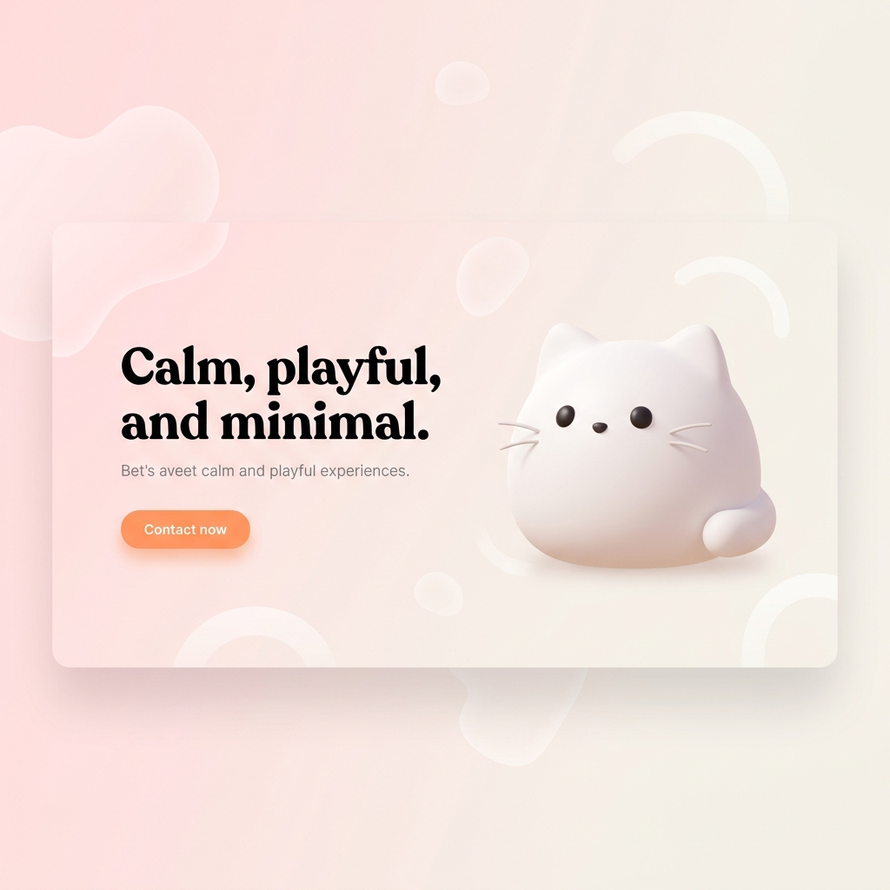

# NyaNudge 🐾
> **Your cat-powered wellness companion.**

NyaNudge reminds you to drink water, eat, move, take bathroom breaks and take your medication, with a crew of animated cats and a witty message on every nudge. Everything stays on the device: no account, no ads, no analytics.

## Features

- **Five reminder categories**, each with fixed times or an interval inside a daily window, on chosen weekdays.
- **Reliable delivery**: one-shot exact alarms planned up to 30 days ahead, topped up whenever the app opens, restored after a reboot.
- **Per-reminder sound**: sound + vibration, vibration only, or silent; quiet hours (medication is exempt).
- **Notification actions**: Done and Snooze from the tray; tapping a notification opens a quick action sheet.
- **Streaks and history**: daily streaks, best streak, 7-day completion rate and a calendar heatmap, computed from the local completion log.
- **Three cats**: Mochi, Kuro and Sora. The animations respect the system "remove animations" setting.
- **Four languages**: English, Brazilian Portuguese, Spanish and Japanese, following the device language.
- **Light and dark themes**, an in-app privacy policy, and an Android back button that closes sheets before leaving a screen.

## Tech stack

React 19 · Vite 8 · Capacitor 8 (Android) · Zustand · SQLite via `@capacitor-community/sqlite` (sql.js in the browser) · i18next · lottie-web and hand-built SVG animations · Vitest, Testing Library and Storybook.

## Getting started

Requirements: Node.js 22 or newer (Capacitor 8), JDK 21 and the Android SDK (compileSdk 36, minSdk 24).

```bash
npm install
npm run dev          # browser preview with sql.js
```

## Testing

```bash
npx vitest run --project=unit --coverage   # unit tests; CI requires 80% coverage
npx vitest run --project=storybook         # Storybook stories with accessibility checks (Playwright)
npm run storybook                          # component explorer
```

CI (`.github/workflows/ci.yml`) runs lint, `tsc -b` and the unit tests with coverage on every push.

## Android build and release

See [docs/android_deployment_guidelines.md](docs/android_deployment_guidelines.md), or run `.agents/tools/deploy-android.sh` to build and install a debug APK on a connected device.

## More docs

- [docs/NyaNudge_PRD.md](docs/NyaNudge_PRD.md): product spec and reminder copy
- [DESIGN.md](DESIGN.md): visual design rules and tokens
- [docs/store-readiness-review.md](docs/store-readiness-review.md): Galaxy Store readiness status
- [docs/privacy-policy.md](docs/privacy-policy.md): the policy to host for the store listing
- [CONTRIBUTING.md](CONTRIBUTING.md): workflow and code standards
